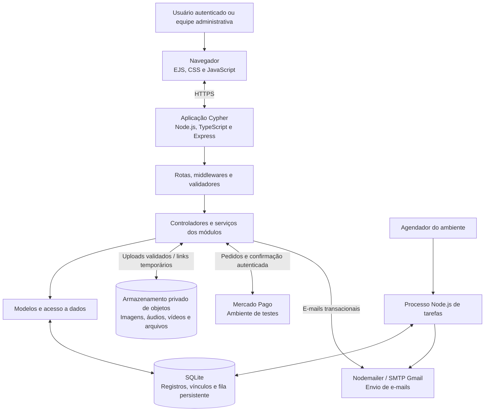

# Arquitetura do Sistema — Cypher
## 1. Visão geral

A Cypher é uma aplicação web destinada à descoberta de artistas e profissionais, à organização de trabalhos e à formação de conexões na cultura hip-hop. O sistema reúne perfis, obras musicais, Banco de Beats, projetos, portfólios, eventos, oportunidades, colaborações e recursos de comunicação. A administração e a Cypher Central complementam essas atividades.

A arquitetura organiza essas funcionalidades em uma aplicação principal, responsável por receber solicitações, aplicar as regras de negócio, consultar os dados e apresentar as páginas. Serviços externos são utilizados apenas para necessidades específicas, como envio de e-mails, armazenamento de mídias e pagamentos demonstrativos.

A solução foi definida para manter o sistema compreensível, com responsabilidades separadas e possibilidade de evolução sem exigir que cada funcionalidade se torne uma aplicação independente.

## 2. Modelo arquitetural

A Cypher adota uma **arquitetura monolítica modular, organizada pelo padrão MVC (Model–View–Controller)**. O backend é executado em **Node.js, com TypeScript e Express**. As páginas são renderizadas com **EJS**, utilizando **CSS e JavaScript sem framework** no navegador.

O termo *monolítica* indica que os módulos principais fazem parte de uma mesma aplicação de servidor. O termo *modular* indica que cada domínio mantém responsabilidades próprias e interfaces internas definidas. Essa escolha permite concentrar autenticação, regras e persistência em um sistema único, sem misturar o funcionamento de todos os módulos no mesmo controlador.

A aplicação é dividida nas seguintes responsabilidades:

| Camada | Responsabilidade |
|---|---|
| Apresentação | Exibir páginas EJS, estilos, formulários e interações em JavaScript. |
| Rotas e controladores | Receber requisições HTTP, encaminhá-las ao fluxo correto e produzir páginas ou respostas para a interface. |
| Middlewares e validadores | Verificar sessão, permissões, dados recebidos e condições de acesso antes da operação. |
| Serviços de aplicação | Coordenar regras de negócio, mudanças de estado e operações que envolvem mais de um módulo. |
| Modelos e acesso a dados | Consultar e persistir registros e relacionamentos, preservando integridade. |
| Integrações | Comunicar-se com armazenamento de objetos, e-mail e Mercado Pago, sem expor credenciais ao navegador. |
| Processos agendados | Executar lembretes e outras tarefas persistentes independentemente de páginas abertas. |

Os serviços de aplicação são uma separação lógica recomendada para concentrar regras que não pertencem às rotas nem às consultas ao banco. Não exigem novo framework ou processo de servidor.

### 2.1. Diagrama geral



O diagrama representa a arquitetura definitiva. O **SQLite é o banco de dados relacional da Cypher**, utilizado pela aplicação e pelo processo de tarefas agendadas. Seu arquivo é mantido em armazenamento persistente e protegido no ambiente do servidor.

## 3. Organização interna da aplicação

O Express é o ponto de entrada das requisições. As rotas indicam qual controlador deve ser acionado; os middlewares analisam as condições gerais de acesso; os validadores conferem os dados; os serviços executam as regras; e os modelos realizam a persistência e a leitura dos registros.

Como exemplo de organização lógica, sem impor uma nomenclatura definitiva de arquivos:

```text
src/
├── aplicacao.ts
├── routes/            # Rotas convencionais e administrativas
├── controllers/       # Recebimento das ações e respostas
├── middlewares/       # Sessões, acesso, erros e proteção de requisições
├── validators/        # Validação de entradas e arquivos
├── services/          # Regras e operações dos domínios
├── models/            # Entidades e acesso aos registros
├── integrations/      # Objetos, SMTP e Mercado Pago
├── jobs/              # Lembretes e tarefas agendadas
├── config/            # Banco e configurações de ambiente
└── views/             # Templates EJS
public/
├── css/
├── js/
└── assets/            # Recursos públicos da interface, sem mídias privadas
```

Essa estrutura ilustra a distribuição das responsabilidades; não afirma que todas essas pastas já existam com esses nomes. O código poderá organizar arquivos de um mesmo domínio em subpastas, desde que mantenha as separações descritas.

### 3.1. Caminho de uma requisição

1. O navegador solicita uma página ou envia uma ação à aplicação por HTTPS.
2. O Express identifica a rota e executa os middlewares correspondentes.
3. O sistema verifica a sessão e as autorizações necessárias, inclusive nas consultas.
4. Os dados enviados são validados no servidor.
5. O controlador chama o serviço responsável pela operação.
6. O serviço aplica as regras, acessa os modelos e realiza as integrações necessárias.
7. O resultado retorna como página EJS renderizada ou resposta usada pelo JavaScript da interface.

Uma opção escondida na interface **não substitui a autorização no servidor**. A mesma verificação se aplica a URLs diretas, compartilhamentos, formulários, downloads e operações administrativas.

## 4. Módulos funcionais

Os módulos abaixo são **divisões de responsabilidade dentro da mesma aplicação**, não microserviços independentes. Uma funcionalidade pode consultar outros módulos, mas não deve alterar seus registros ignorando as regras do responsável original.

| Módulo | Responsabilidade principal | Referência funcional |
|---|---|---|
| Contas e autenticação | Cadastro de Consumidor e Profissional, confirmação de e-mail, login, sessões, recuperação de senha, conversão de conta e encerramento. | RF-001–010 |
| Perfis e privacidade | Perfil profissional único, apresentação por profissão, informações pessoais e visibilidade de dados e conteúdos. | RF-011–019 |
| Profissões e permissões | Catálogo de 25 profissões, vínculos com cada profissional, alterações autorizadas e capacidades de publicação. | RF-020–029 |
| Obras e créditos musicais | Composições, letras, fonogramas, lançamentos, faixas, funções exercidas e reconhecimento de créditos. | RF-030–040 |
| Banco de Beats | Beats, prévias, ofertas Free Use e Premium, pedidos de testes, licenças e entrega de arquivos. | RF-041–055 |
| Espaço de Trabalho e projetos | Organização de trabalhos próprios e participações, projetos, experiências e galerias multimídia. | RF-056–062 |
| Portfólios | Vitrine unificada, seleção Manual ou Inteligente, organização, moldes e ocultações persistentes. | RF-063–069 |
| Selos Profissionais | Identidade visual individual, versões e aplicação em contribuições reconhecidas. | RF-070–074 |
| Eventos | Realizações e edições, inscrições, confirmação, presença, mudanças e avaliações pós-evento. | RF-075–087 |
| Oportunidades | Publicação de chamadas, candidaturas, acordos e pedidos excepcionais de Consumidores sujeitos a triagem. | RF-088–093 |
| Colaborações e reputação | Propostas bilaterais, conclusão confirmada, avaliações duplo-cegas e reputação profissional. | RF-094–104 |
| Interações e mensagens | Seguir, curtir, salvar, comentar, bloquear e manter conversas privadas. | RF-105–112 |
| Notificações | Avisos persistentes, preferências, leitura, exclusão e lembretes de eventos. | RF-113–118 |
| Descoberta e pesquisa | Página inicial, busca, filtros adequados a cada conteúdo, recomendações e links compartilháveis. | RF-119–125 |
| Cypher Central | Consulta e pesquisa educativa, gestão editorial, feedback e indicadores de qualidade. | RF-126–131 |
| Administração e moderação | Acesso administrativo separado, papéis, denúncias, solicitações, decisões, recursos e auditoria. | RF-132–142 |

As exigências de **reutilização de registros, autorização, privacidade e distinção entre fatos declarados e confirmados** são transversais a todos os módulos (RF-143–146).

### 4.1. Limites entre os domínios

Algumas separações são obrigatórias para evitar informações incorretas:

- **Composição, letra, fonograma e lançamento** são registros diferentes. A mesma gravação pode integrar mais de um lançamento sem ser duplicada; sua posição na lista de faixas pertence a cada lançamento.
- **Beat** é um registro próprio, com ofertas e licenças próprias. Vinculá-lo a uma música não comprova aquisição, cessão ou propriedade.
- **Projeto** organiza atividades e entregas, mas não comprova, por si, uma Collab formal nem a autoria de materiais relacionados.
- **Portfólio e galerias** apresentam registros existentes; não recriam a obra nem transferem direitos.
- **Evento e oportunidade** são domínios diferentes. Um evento pode demandar profissionais, mas a publicação de uma chamada não concede poderes de organização.
- **Interesse, inscrição, confirmação e presença** em evento são fatos distintos.
- **Crédito reconhecido** e **colaboração formal concluída** são vínculos distintos; um não substitui o outro.
- **Feedback de evento** não constitui avaliação da reputação profissional.
- **Selo Profissional** identifica uma pessoa e sua contribuição reconhecida; não há um sistema autônomo de insígnias colecionáveis de eventos.

## 5. Persistência e organização dos dados

O banco relacional guarda contas, informações profissionais, registros de conteúdo, relacionamentos, permissões, histórico e estados de processos. O **SQLite é o banco de dados definitivo da Cypher**, com acesso centralizado nos modelos da aplicação. O arquivo do banco deve permanecer em armazenamento persistente e protegido, separado dos recursos públicos da interface.

### 5.1. Grupos de dados

| Grupo | Exemplos de registros e vínculos |
|---|---|
| Identidade e acesso | Contas, credenciais protegidas, sessões, confirmações, papéis administrativos, consentimentos e histórico de @username. |
| Atuação profissional | Profissões, tempo de atuação, especialidades, permissões contextuais e representação profissional reconhecida. |
| Produção musical | Composições, letras, fonogramas, lançamentos, faixas, créditos e reconhecimentos. |
| Beats e licenças | Beats, versões de ofertas e termos, pedidos demonstrativos, confirmações, licenças e entregáveis. |
| Trabalhos e apresentação | Projetos, experiências, galerias, referências de mídia, itens de portfólio, preferências de curadoria e versões de selos. |
| Eventos e oportunidades | Séries/edições de eventos, inscrições, presenças, reclamações, chamadas, candidaturas e acordos. |
| Colaborações e reputação | Convites, aceite, conclusão, contestações, avaliações, liberações e resultados calculados. |
| Comunicação | Acompanhamentos, curtidas, itens salvos, comentários, bloqueios, conversas e mensagens. |
| Notificações | Avisos, preferências, lembretes agendados, tentativas e resultados de execução. |
| Conteúdo educativo e administração | Artigos, revisões, feedback, pesquisas sem resposta, denúncias, solicitações, decisões e trilhas de auditoria. |

Esses grupos orientam a futura modelagem de dados. Não definem antecipadamente o nome ou a quantidade final de tabelas; essas decisões devem ser detalhadas no Modelo Lógico e no DER.

### 5.2. Integridade e histórico

Cada registro principal deve possuir **identificador interno estável**. Referências exibidas em Descoberta, perfis, portfólios, compras e outras áreas devem apontar para o mesmo objeto de origem, evitando cópias independentes de conteúdo e métricas.

O banco deve utilizar relacionamentos consistentes, restrições de unicidade e transações nas operações que alteram vários registros. Repetições de requisições, confirmações de pagamento, inscrições e avaliações não podem gerar duplicações indevidas. Mudanças de @username, profissão, visibilidade ou situação da conta não devem apagar créditos, direitos ou licenças que precisem ser preservados.

A arquitetura também separa **declarações** de **fatos confirmados**. Cadastro de obra não comprova lançamento público; menção a profissional não confirma crédito; projeto não comprova Collab; pedido de teste não representa pagamento real. Os estados e evidências devem ficar associados aos processos que efetivamente os validam.

**Não serão utilizados estados artísticos de obra** como “Rascunho”, “Em produção” ou “Lançado”. Existência do registro, acesso, mídia e comprovação factual de lançamento são aspectos independentes.

### 5.3. Evolução e manutenção do SQLite

A estrutura do banco deve evoluir por **migrações versionadas e reproduzíveis**, com preservação dos registros, identificadores, relacionamentos e históricos válidos. O procedimento adotado é:

1. Definir e versionar a alteração do esquema SQLite.
2. Criar uma cópia de segurança consistente do banco antes de alterações estruturais e preservar os vínculos com arquivos de mídia.
3. Aplicar as alterações de forma controlada, utilizando transações quando cabíveis.
4. Verificar a integridade do esquema, as restrições de unicidade, as chaves estrangeiras e os relacionamentos afetados.
5. Validar os fluxos essenciais e a possibilidade de restauração antes da disponibilização da versão atualizada.

As conexões devem habilitar a verificação de chaves estrangeiras (`PRAGMA foreign_keys = ON`). O acesso concorrente da aplicação e do processo agendado deve utilizar transações curtas e tratamento de bloqueios, com configuração de journal adequada ao ambiente. O acesso aos dados permanece concentrado nos modelos; os procedimentos operacionais serão detalhados na documentação do Banco de Dados.

## 6. Armazenamento e acesso às mídias

Imagens, áudios, vídeos e arquivos de entrega ficam em **armazenamento de objetos privado**, separado do banco relacional. O SQLite conserva o identificador do objeto, seu vínculo com o conteúdo original, os dados necessários de controle e a visibilidade aplicável.

### Envio de mídia

1. O profissional autenticado solicita o envio para um registro que tem autorização para administrar.
2. O backend valida a operação, os dados do arquivo e as regras de tipo, tamanho e conteúdo permitido.
3. O arquivo é armazenado no serviço privado; o sistema registra a referência vinculada ao conteúdo e aos direitos de acesso.
4. Se alguma etapa falhar, o envio não é apresentado como concluído; objetos ou referências incompletas devem ser tratados por recuperação ou limpeza controlada.

### Consulta ou download

1. O usuário solicita a mídia vinculada a uma obra, galeria, beat ou licença.
2. O backend verifica sessão, visibilidade, bloqueios, moderação e permissões específicas do objeto.
3. Quando permitido, emite um **link temporário** para o objeto correspondente.
4. O armazenamento entrega o arquivo pelo período limitado do link; um novo acesso exige nova autorização.

Arquivos integrais de beat, stems, letras privadas, documentos de licença e anexos reservados não podem ficar acessíveis como arquivos estáticos públicos. Os links devem ter validade curta e não ser usados como prova permanente de autorização; para materiais especialmente sensíveis, a política poderá exigir mediação adicional pelo servidor.

O **provedor de armazenamento** e os **limites por tipo de arquivo** permanecem em definição. A arquitetura não depende da escolha antecipada de um fornecedor específico.

## 7. Integrações externas e processos independentes

### 7.1. E-mail

A aplicação utiliza **Nodemailer com SMTP autenticado do Gmail**, além do modo local de testes já previsto. O envio de confirmações de e-mail e recuperação de senha é acionado pelo backend, que controla validade, uso único e frequência de emissão. Credenciais e dados de conexão permanecem na configuração segura do servidor.

O envio de e-mail é um meio de comunicação, não substitui o registro persistido de avisos, licenças ou outras operações dentro da Cypher.

### 7.2. Mercado Pago — compra Premium demonstrativa

A integração utiliza exclusivamente o **ambiente de testes do Mercado Pago** para aquisição de uma oferta Premium **não exclusiva** por pedido, sem cobrança de dinheiro real.

1. O comprador autenticado escolhe uma oferta Premium válida.
2. O backend registra o pedido com comprador, beat, oferta, versão dos termos e valor aplicáveis naquele momento.
3. O servidor inicia a operação de teste junto ao Mercado Pago.
4. O retorno do navegador mostra o andamento, mas **não confirma** a aprovação por conta própria.
5. O backend recebe ou consulta a confirmação por canal autorizado, valida a operação e confere sua correspondência com o pedido original.
6. Somente após aprovação verificada o pedido é concluído, com registro **único** da licença demonstrativa e liberação dos arquivos de entrega autorizados.
7. O comprador consulta a licença e os materiais em **Minhas Compras**, respeitando seus controles de acesso.

Confirmações repetidas ou fora de ordem não podem emitir várias licenças para a mesma operação. Falhas externas preservam o pedido em situação coerente e permitem uma verificação posterior, sem inventar aprovação. A exclusividade permanece fora desse checkout automatizado.

### 7.3. Lembretes e fila persistente

Os lembretes de eventos são organizados em **fila persistente no SQLite** e executados por **um processo Node.js acionado pelo agendador do ambiente**. Esse processo opera independentemente de o usuário manter uma página aberta. A leitura e a atualização das tarefas devem usar operações transacionais que evitem o processamento duplicado.

1. Ao registrar interesse ou outra condição válida de acompanhamento, a aplicação cria os lembretes previstos para **24 horas antes** e **no dia do evento**, considerando o horário local de realização e as preferências do usuário.
2. Se data, inscrição, interesse ou cancelamento mudar, os lembretes correspondentes são atualizados ou cancelados.
3. A cada execução, o processo identifica tarefas pendentes e confirma novamente as condições do evento e da conta.
4. O aviso válido é registrado como notificação persistente; eventuais e-mails seguem as configurações e a finalidade aplicável.
5. Falhas ficam registradas para nova tentativa controlada; a identificação da tarefa evita avisos duplicados para o mesmo fato.

A fila e o processo agendado **fazem parte da arquitetura final, mas ainda precisam ser implementados**. O horário específico do lembrete “no dia” será parametrizado conforme as regras de comunicação adotadas, sem presumir um horário que não foi definido na documentação.

## 8. Autenticação, autorização e privacidade

### 8.1. Acesso convencional

A Cypher admite duas modalidades convencionais: **Consumidor** e **Profissional**. O cadastro exige idade mínima de **16 anos** e confirmação do e-mail. As sessões convencionais possuem validade máxima de **24 horas**. Usuários de 16 e 17 anos recebem proteção reforçada de dados e contatos.

Todas as páginas e operações internas exigem autenticação, inclusive Descoberta, perfis, catálogos, portfólios, arquivos compartilhados e Cypher Central. Sem sessão, permanecem acessíveis somente os procedimentos de cadastro, login, confirmação de e-mail e recuperação de acesso. Integrações externas autorizadas, como notificações técnicas do Mercado Pago, são autenticadas por seu mecanismo próprio e não por sessão de usuário.

### 8.2. Permissões por contexto

Para criar um registro profissional, o backend precisa conferir conjuntamente:

- Profissão ativa compatível com a publicação.
- Vínculo legítimo com o objeto ou trabalho.
- Titularidade ou autorização adequada para a operação solicitada.

A permissão de **visualizar** não concede a de **editar, apagar, publicar, licenciar ou baixar**. Um crédito confirmado também não concede automaticamente administração do conteúdo original. A verificação deve utilizar a conta solicitante e o estado atual dos registros, não apenas informações enviadas pelo navegador.

A seleção inicial de profissões não consome uma alteração. A primeira mudança posterior é livre; mudanças ordinárias seguintes respeitam intervalo de **30 dias**, ressalvada a análise de exceções. A retirada de profissão limita novas publicações dependentes dela, mas não apaga automaticamente direitos e registros anteriores.

### 8.3. Área administrativa

A autenticação administrativa é separada da convencional. Há três papéis: **Administrador Geral**, **Moderador** e **Editor**, cada qual restrito às próprias competências. Contas administrativas são provisionadas por procedimento controlado; não são criadas pelo cadastro público nem recebem perfil profissional por serem administrativas.

Denúncias, recursos, alterações de privilégios, decisões e consultas excepcionais a evidências devem possuir autorização específica e histórico auditável. Administradores não recebem acesso indiscriminado a conversas privadas, credenciais, arquivos ou informações pessoais dos usuários.

### 8.4. Proteções gerais

A aplicação deve utilizar **HTTPS** quando acessível pela internet; senhas armazenadas com derivação criptográfica e sal individual; sessões protegidas e revogáveis; validação de entradas; consultas parametrizadas; proteção contra falsificação de requisições; limites de tentativas; e tratamento seguro de arquivos. Segredos e credenciais não são incluídos no código público nem enviados ao navegador.

A privacidade é aplicada também nas consultas de Busca e Descoberta, miniaturas, links compartilhados, notificações e referências de portfólio. Bloqueios, retirada de conteúdo e decisões de moderação devem refletir nas diferentes áreas sem apagar indevidamente direitos e histórico de terceiros. O tratamento de dados pessoais deve observar finalidades, retenção e medidas pertinentes à **LGPD**.

## 9. Fluxos que exigem consistência entre módulos

### 9.1. Publicação de trabalho e confirmação de crédito

O profissional cria um registro autorizado. O serviço de conteúdo persiste os dados e os vínculos de participação. Quando o crédito é atribuído a outra pessoa, a indicação permanece distinta de um **crédito confirmado** até o reconhecimento válido do profissional correspondente. Perfil, portfólio e pesquisa consultam o mesmo registro e apresentam o reconhecimento conforme seu estado real.

### 9.2. Portfólio Manual e Inteligente

O modo **Manual** utiliza as escolhas do titular. O modo **Inteligente** seleciona trabalhos próprios elegíveis e participações confirmadas, respeitando visibilidade e ocultações persistentes. Alterar modo ou molde de apresentação não modifica a origem, os créditos nem os arquivos dos trabalhos.

### 9.3. Evento e avaliação pós-evento

A organização de um evento exige profissão ou delegação compatível. Interesse, inscrição, admissão, presença e avaliação ficam registrados separadamente. Reclamações sobre a organização passam inicialmente pelo organizador; contestações podem ser encaminhadas à moderação. Reconhecer uma falha não acarreta punição automática. A avaliação pós-evento não interfere na reputação decorrente de colaborações formais.

### 9.4. Colaboração e reputação

A proposta envolve duas contas Profissionais distintas e requer aceite bilateral. O convite não respondido expira em **30 dias**. A conclusão exige confirmação das duas partes ou decisão excepcional de moderação, sem presumir encerramento unilateral.

Após conclusão válida, cada parte pode enviar uma avaliação no prazo de **14 dias**, em comunicação, cumprimento de combinados e trabalho em equipe. As notas seguem o modelo **duplo-cego**: são liberadas depois do envio por ambas as partes ou do término do prazo. A média pública aparece apenas quando houver avaliações válidas de **três profissionais distintos**, com peso igual por avaliador. Sem avaliações, o perfil informa “Ainda sem avaliações”; com um ou dois avaliadores distintos, apresenta “Reputação em formação”.

### 9.5. Solicitações e moderação

Pedidos excepcionais de Consumidores, disputas de créditos, denúncias e contestações são encaminhados aos responsáveis competentes. A aplicação guarda estado da solicitação, participantes autorizados, evidências pertinentes, decisões e recursos. Medidas de ocultação, suspensão e remoção não são tratadas como a mesma operação, e o histórico é preservado na medida necessária.

## 10. Requisitos de qualidade e operação

A arquitetura deve oferecer meios de cumprir e testar os requisitos não funcionais da Cypher.

| Aspecto | Diretriz de arquitetura |
|---|---|
| Desempenho | Índices e consultas adequadas, paginação de listagens e carregamento eficiente de mídias. Nos ensaios definidos, 95% das páginas iniciais e operações comuns até **3 s**, e 95% das buscas e filtros locais até **2 s**. |
| Carga de referência | Homologação com **20 sessões simultâneas**, pelo menos **1.000 perfis, 500 trabalhos, 200 beats, 100 eventos e 100 oportunidades**. |
| Acessibilidade | Critérios aplicáveis da **WCAG 2.2 AA**, teclado, foco visível, contraste, controles acessíveis e interface responsiva a partir de **360 px**. |
| Compatibilidade | Fluxos essenciais em versões estáveis atuais de Chrome, Firefox, Edge e Safari. |
| Integridade | Transações, referências válidas, operações idempotentes e tratamento de falhas sem apresentar sucesso fictício. |
| Continuidade | Dados persistidos fora da memória do processo; backup de banco e arquivos, restauração testada e agendamentos independentes do navegador. |
| Manutenção | Componentes separados, configuração por ambiente, evolução versionada do esquema e testes reproduzíveis. |
| Auditoria | Registro de falhas e ações sensíveis com autor, objeto e resultado, sem inclusão desnecessária de dados privados ou segredos. |
| Indicadores | Contadores, métricas e reputação calculados a partir de registros legítimos, sem valores demonstrativos tratados como reais. |

Antes de alterações estruturais, deve haver backup recuperável. A restauração precisa ser validada em ambiente de teste. A aplicação e o processo agendado devem registrar falhas de forma suficiente para investigação, sem expor senhas, tokens ou mensagens privadas desnecessárias.

### 10.1. Testes necessários à validação da arquitetura

Os testes devem cobrir, no mínimo, casos autorizados e recusados de cadastro, autenticação, permissões por profissão, acesso a conteúdo privado, obras, créditos, ofertas, compra Premium de testes, downloads, eventos, notificações e moderação. Devem incluir operações repetidas, falha de integração, mudança de visibilidade, reinício da aplicação e restauração de dados.

## 11. Implantação e componentes de execução

A implantação final envolve os seguintes elementos, que podem compartilhar a infraestrutura física conforme as condições do ambiente:

1. **Navegador do usuário:** apresenta as páginas e solicita operações ao servidor.
2. **Processo da aplicação Express:** atende requisições, executa validações, regras, renderização EJS e integrações.
3. **Banco SQLite em armazenamento persistente:** mantém informações da plataforma, relações e fila de tarefas em arquivo protegido, acessado pelos processos autorizados.
4. **Armazenamento de objetos privado:** mantém mídias e arquivos associados aos registros.
5. **Processo Node.js agendado:** lê tarefas persistidas, revalida condições e executa lembretes.
6. **Serviços externos:** SMTP Gmail para e-mails e Mercado Pago em ambiente de testes para compras demonstrativas.

O acesso externo à aplicação deve utilizar HTTPS. O arquivo SQLite deve permanecer fora de diretórios públicos, com permissões de acesso restritas aos processos autorizados. O armazenamento de objetos e os serviços integrados também devem utilizar controles de acesso e credenciais protegidas. A aplicação e o processo agendado utilizam a mesma base persistente, em ambiente de arquivos compatível com os mecanismos de bloqueio do SQLite; o processo de tarefas não depende de requisições de usuários.

A escolha do provedor de hospedagem, do armazenamento de objetos, das cotas de mídia e dos detalhes do agendador permanece em aberto. Esses pontos são **parâmetros de implantação**, e não motivos para alterar a organização lógica definida.

## 12. Decisões consolidadas e limites

A arquitetura considera como decisões estabelecidas: Node.js, TypeScript e Express; páginas EJS; CSS e JavaScript sem framework; separação por MVC; SQLite como banco definitivo; objetos privados para mídias; Nodemailer com SMTP Gmail; fila persistente e processo Node.js agendado; Mercado Pago em modo de testes para compras Premium não exclusivas.

O projeto não inclui distribuição musical como serviço de streaming, emissão de ISRC ou ISWC, pagamento real de beats no TCC, checkout automatizado de exclusividade ou um sistema de insígnias colecionáveis de eventos. Nenhum módulo interno possui acesso anônimo.

Esta arquitetura representa o **sistema final previsto**, incluindo componentes ainda pendentes de implementação. A modelagem detalhada das tabelas e chaves pertence à etapa de Modelagem de Dados; as telas e interações específicas pertencem aos Fluxos de Navegação e Wireframes. O objetivo aqui é estabelecer **como o sistema se organiza, como seus componentes se comunicam e quais regras devem ser preservadas** para que a Cypher funcione de modo consistente.
